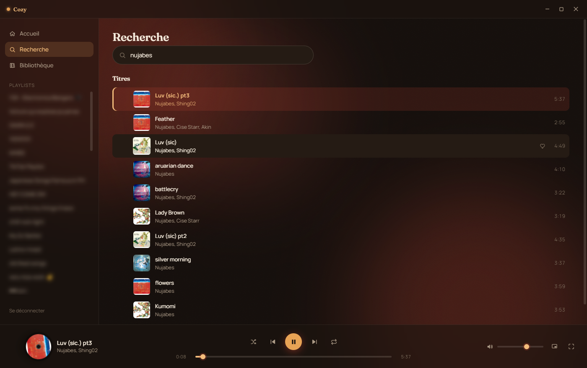
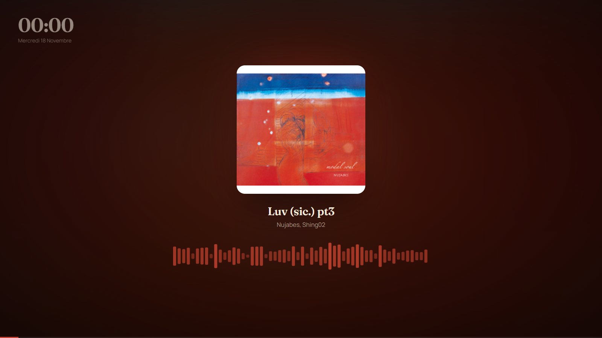
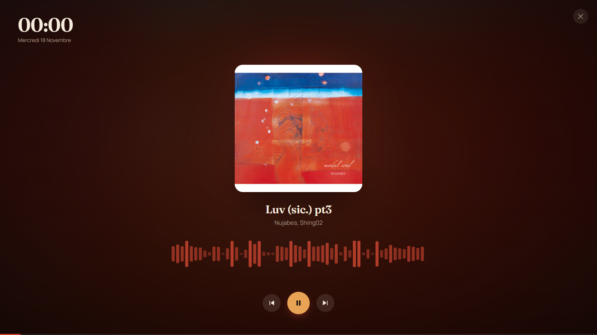
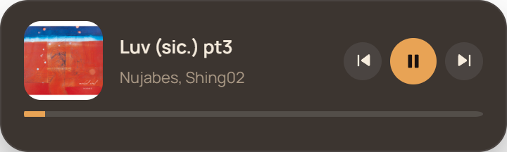

<div align="center">

# 🕯️ Cozy

**Un lecteur Spotify de bureau, chaleureux et moderne.**
Ambiance tamisée, couleurs qui suivent la pochette, vinyle qui tourne — pour Windows et Linux.




</div>

---

## ✨ Ce que ça fait

- 🎨 **Thème qui respire** — fond ambiant animé dont les couleurs sont extraites en direct de la pochette en cours, verre dépoli, police Fraunces.
- 💿 **Vinyle qui tourne** pendant la lecture, égaliseur animé sur le titre en cours, transitions fluides entre les pages.
- 🔎 **Recherche, playlists, bibliothèque** — double-clic pour lancer un titre, ❤️ pour liker.
- 🖥️ **Mode affichage plein écran** — pochette géante, horloge, visualiseur animé : parfait sur un second écran.
- 🪟 **Mini-lecteur flottant** toujours au premier plan, à poser n'importe où sur le bureau.
- 🔒 **Aucun secret embarqué** — connexion OAuth PKCE, identifiants chiffrés localement.

## 🖥️ Mode affichage

Un mode ambiance pensé pour tourner en continu sur un écran dédié. Les contrôles et le curseur disparaissent après quelques secondes d'inactivité et réapparaissent dès que la souris bouge.

<table>
  <tr>
    <td></td>
    <td></td>
  </tr>
  <tr>
    <td align="center"><sub>Au repos</sub></td>
    <td align="center"><sub>Souris en mouvement</sub></td>
  </tr>
</table>

| Touche | Action |
| :----: | ------ |
| `Espace` | Lecture / pause |
| `←` `→` | Titre précédent / suivant |
| `Échap` | Quitter le mode affichage |

## 🪟 Mini-lecteur

Une petite fenêtre flottante qui reste au-dessus de toutes les autres applis : titre, timeline cliquable, précédent / lecture / suivant. Elle s'ouvre avec le bouton dédié de la barre de lecture, ou **automatiquement quand tu réduis la fenêtre principale**.

<p align="center">
  
</p>

## 🚀 Installation

**Prérequis :** [Node.js](https://nodejs.org/) 22.15+ et un compte **Spotify Premium**.

```bash
git clone https://github.com/sershoks/cozy-player.git
cd cozy-player
npm install
npm run dev
```

`npm install` télécharge aussi automatiquement le moteur audio [go-librespot](https://github.com/devgianlu/go-librespot) pour ta plateforme (et, sous Windows, les DLLs audio dont il a besoin).

### Premier lancement

1. Crée une app (gratuite) sur le [dashboard développeur Spotify](https://developer.spotify.com/dashboard) et ajoute cette **Redirect URI** dans ses réglages :
   ```
   http://127.0.0.1:43231/callback
   ```
2. Colle le **Client ID** de ton app dans Cozy, puis connecte-toi — ça sert à la recherche, aux playlists et à la bibliothèque.
3. Un second onglet s'ouvre pour autoriser la **lecture audio** (go-librespot utilise son propre client Spotify, nécessaire pour le streaming). Approuve, c'est mémorisé pour les fois suivantes.

> [!NOTE]
> Sous Windows, le pare-feu peut demander d'autoriser `go-librespot.exe` au premier lancement : accepte, c'est le moteur audio local.

## 📦 Build

```bash
npm run build:win     # installeur Windows (NSIS)
npm run build:linux   # AppImage + .deb
```

## 🧩 Comment ça marche

```
Renderer (React) — interface, mode affichage, mini-lecteur
        │
        │  IPC via le preload (window.cozy)
        ▼
Main process (Electron)
  ├─ OAuth PKCE + API Web ──────────► api.spotify.com
  └─ go-librespot (sous-processus) ─► carte son (WASAPI / PulseAudio)
```

- **Audio** — [go-librespot](https://github.com/devgianlu/go-librespot) tourne en sous-processus local et décode le flux Spotify Connect directement vers la carte son. Pas de DRM ni de navigateur intégré, donc ça marche pareil sous Windows et Linux.
- **Navigation** — l'API Web officielle de Spotify (recherche, playlists, titres likés) via OAuth PKCE, sans secret client.
- **Stockage** — le Client ID et les jetons restent sur ta machine, dans le dossier de données de l'app ; les jetons sont chiffrés via le trousseau du système.

```
src/
  main/       processus principal : go-librespot, auth, API Web, fenêtres
  preload/    pont sécurisé exposé au renderer (window.cozy)
  renderer/   interface React
  shared/     types partagés
scripts/      téléchargement de go-librespot (+ DLLs Windows)
```

## ⚠️ Limites connues

- Depuis la [migration de l'API Spotify de février 2026](https://developer.spotify.com/documentation/web-api/tutorials/february-2026-migration-guide), seul le contenu des playlists **que tu possèdes ou sur lesquelles tu collabores** est accessible. Les playlists suivies et celles générées par Spotify (Discover Weekly…) apparaissent mais ne peuvent pas être ouvertes.
- Le visualiseur du mode affichage est une animation : l'audio étant décodé hors du navigateur, il ne réagit pas au son réel.

## 📄 Licence

[Apache 2.0](LICENSE)
